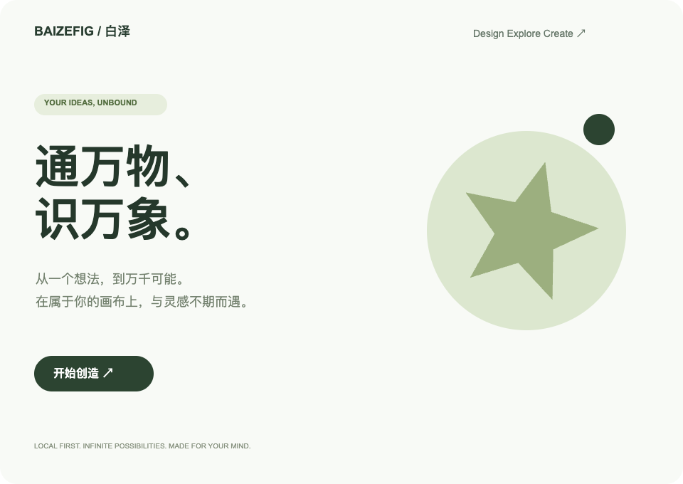

  
  <h1>BaizeFig · 白泽</h1>
  
<strong>通万物、识万象。</strong>

  
把想法放上画布，让设计一步步成为可以体验的作品。

BaizeFig 是一款本地优先的设计工具。名字取意于白泽，希望让复杂的设计信息更容易被理解，让创作者在同一个工作区中完成绘制、排版、组件复用与原型演示。

从一个简单图形开始，也可以导入已有的 Figma 文件继续创作。设计文件保存在当前浏览器中，支持导出备份；界面默认中文，也可随时切换 English。

## 一张画布，容纳你的想法

自由平移和缩放画布，用画板组织桌面端、移动端与不同方案。图层列表直接显示作品缩略图，形状、曲线、图片与分组一眼可辨，修改后同步更新。通过智能吸附、标尺参考线、等距分布和整理，把零散想法排成清晰的设计。图层与页面可以拖放排序，移入或移出容器时保留位置；多选缩放、翻转和画布旋转让调整更直接。

矩形、圆形、直线、多边形、星形、文本与图片都可以成为创作素材。填充、描边、圆角、透明度、渐变、阴影和模糊，让画面逐渐形成自己的表达。支持蒙版与布尔组合，也能在旋转的图层中调整尺寸。

## 把轮廓雕琢成想要的样子

双击图形即可进入矢量编辑，直接移动节点与贝塞尔控制柄。尖角和平滑、自由和镜像控制柄，让图标、曲线与自定义图形更容易调整；支持添加节点、平滑连接、断开和删除修复；也能按容差简化路径、向内或向外偏移轮廓，或拆成可独立修改的图层。每一步都支持撤销重做。

一个图形中的不同区域可以拥有自己的多层填充：纯色、渐变、图片和透明度，也能保留孔洞与填充规则。需要交付路径时，可将描边转换为填充轮廓，或将布尔组合拼合为可继续编辑的路径，带入 SVG、PNG 和本地设计副本。

## 让变化更容易

钢笔逐点落下锚点，拖拽拉出曲线控制柄，点击起点闭合形状；铅笔随手绘制自由曲线，完成后仍可编辑节点。

双击画布中的文字，光标就出现在文字里。直接选中、输入、删除与换行，右侧面板专注字体、字号和颜色；修改支持撤销重做。选中一段文字，即可单独设置粗体、斜体、下划线、删除线、颜色和链接；字体检测与替换帮助你处理当前设备缺少的字体。优先使用已安装字体，缺少 Inter 时可使用内置兼容字体，矢量导出也能带上这份字体。编号与项目符号列表支持续写和缩进；字间距、段距、文字方向与大小写均可调整。在高级字体设置中调整连字、等宽数字和可变字体轴，让数字对齐、字形与字重更合适。中英及其他语言可以混排，自动方向逐段识别；从右向左的段落在换行后也保留方向。文字也可以随内容与宽度重新排版。横纵自动布局、换行布局与网格布局帮助你组织内容；尺寸约束、间距、内边距和对齐规则，让修改少一些重复劳动。

从画布取色，也能保留图形的透明度。调整描边位置、端点、连接和虚线；在画布上拖动、缩放图片，完成裁切。复制一份样式，批量应用到多个图层；把常用外观设为工具默认属性，下次绘制时继续使用。搜索整个文件的文字和图层名，定位到页面，也可以一次替换并撤销。复制的图形可以覆盖在选区上，或直接替换目标；需要带到其他工具时，也可复制为 SVG 或 PNG。

导入时可保留普通文字保存的原始字形，让缺少字体的设备也能继续查看原有外观；文字仍可双击修改，修改后使用当前可用字体重新排版。原文件保存的实线下划线与删除线也能保留位置和厚度。支持导入网页与邮件文字链接；只调整局部颜色或链接时保留已有字形。

导入的路径文字也能继续修改内容，沿曲线排列，并调整位置与方向；保存的原始字形帮助保留初始外观，修改后使用当前设备可用字体重新排版。

把经常使用的设计做成组件，实例会跟随主组件更新，同时保留局部修改。需要时可以重置覆盖、交换组件，或分离实例自由编辑。

颜色、数字、文本和布尔变量可以承载设计中的重复值。配合变量模式与图层模式，为不同主题和内容状态保留一致的表达。

## 从静态画面走向体验

用点击、悬停、按下、松开或延时触发交互，在预览中串联页面。支持跨页跳转、覆盖层、返回与淡入过渡，组件也能通过交互切换状态，悬停移出后恢复；也可以点击滚动到指定内容，为长页面和嵌套滚动区域设置方向、偏移与动画，让设计讨论更接近真实的使用过程。

## 带着已有作品继续创作

- **导入 Figma 文件**：读取 `.fig` 中的页面、图层、文字、图片和组件等内容，并展示兼容性说明。
- **管理本地作品**：自动保存、多文件切换；删除后进入回收站，也可以恢复。电脑上的原始文件不受影响。还可以保存命名版本、比较差异，恢复前自动备份。为方案创建设计分支，独立探索后逐字段比较、解决冲突并合并到主设计。
- **保存与分享成果**：导出原生 `.baizefig` 文件作为可编辑备份，或统一导出选区、页面和多个画板：PNG、JPG、SVG、HTML，以及可调整页序的 PDF。PDF 以保真图像保存当前外观，适合预览与交付；可编辑路径请选择 SVG。

文件保存在当前浏览器内，保存失败可直接重试、导出或另存副本；多标签页旧内容不会静默覆盖新版本。重要作品建议定期导出备份。清理浏览器数据可能移除本地作品和回收站。

## 让 AI 参与创作

连接你自己的兼容模型服务，把设计意图转成可预览的编辑操作。确认后应用到画布，也可以撤销。支持通过本地 MCP 接入外部工具，读取文档、查看选区和执行经授权的编辑。

模型服务由你配置；使用 AI 时，相关设计内容会发送到该服务。

## 与白泽一起成长

BaizeFig 仍在持续开发，以逐步对齐 Figma Design 的创作体验为目标。上文介绍的是已接入的能力，并不代表所有复杂场景都已与 Figma 等价。

目前 `.fig` 属于兼容性导入，尚不能无损还原全部字体、角度/菱形渐变、多重描边、变体属性与高级原型行为；不支持写回 `.fig`。请保留原始文件。智能体、资源、工具、变量四个侧栏入口暂处于研究中，已有的组件与变量能力可从属性面板等入口使用。

[查看功能进展](https://github.com/loyo-sun/BaizeFig/issues/30) · [反馈问题](https://github.com/loyo-sun/BaizeFig/issues) · [功能支持范围](docs/FIGMA_PARITY.md)

本地组件库支持版本发布、跨文件引用和独立库文件分发；按需接受更新，保留实例定制，离线也能继续编辑。

组件可以通过文字、显示开关、图标交换和变体快速调整；一个属性可同步调整多个图层。导入 Figma 后，已识别的组件属性和变体也可继续使用。插槽允许自由添加内容，保留设计规范和主组件更新。

SVG 图标可以作为可编辑矢量导入，保留分组、路径、孔洞和常见渐变裁剪；进入节点编辑后继续打磨曲线。

自动布局可直接调整宽高适应／填充、四边内边距、换行、网格轨道与跨行列；从按钮到嵌套界面，内容变化时同步更新尺寸。

---

想在本地运行或参与开发？请阅读 [开发与接入指南](docs/DEVELOPMENT.md)。[快捷键](docs/SHORTCUTS.md) · [架构说明](docs/ARCHITECTURE.md) · [验证记录](docs/VERIFICATION.md)

常见个人设计是当前重点；大文档的实际测量与可用范围见[性能记录](docs/PERFORMANCE.md)，帮助菜单也可打开本机性能诊断。
